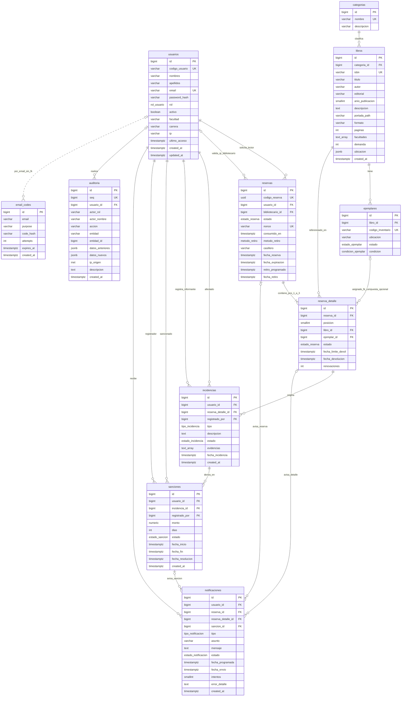

# BiblioQR — Evaluación del Diagrama v3 y Propuesta Implementada V4 (PostgreSQL)

## 1. Evaluación del diagrama PDF (`diagrama_biblioteca_v3.pdf`) frente a la web

El diagrama PDF v3 plantea un esquema relacional normalizado en PostgreSQL de **10 tablas** centrado en circulación por reservas multi-libro, trazabilidad de incidencias, sanciones y avisos. La aplicación web heredada operaba con **8 modelos** orientados a SQLite/PostgreSQL con reservas 1:1, préstamos en tabla aparte (`Loan`), autenticación mixta (`EmailCode` para OTP de estudiantes y contraseña para personal), QR firmado con HMAC y auditoría append-only.

### Tabla comparativa: Diagrama PDF v3 vs Web heredada vs Modelo V4 implementado

| Dominio | Diagrama PDF v3 | Web heredada | Modelo V4 (`prisma/schema.prisma`) |
|---|---|---|---|
| **Usuarios y acceso** | `usuarios` (`BIGINT`, `codigo_estudiante`, `nombres`, `apellidos`, `email`, `password_hash`, `rol`, `activo`, `created_at`, `updated_at`) | `User` (`cuid`, `code`, `name`, `email`, `role`, `status`, `passwordHash`, `faculty`, `career`, `ip`, `lastAccess`) + `EmailCode` | `usuarios` (`BIGSERIAL`, `codigo_usuario`, `nombres`, `apellidos`, `email`, `password_hash` con `DEFAULT ''`, `rol`, `activo`, `facultad`, `carrera`, `ip`, `ultimo_acceso`, `created_at`, `updated_at`) + `email_codes` independiente por `email` (sin FK a `usuarios`). |
| **Categorías y Libros** | `categorias` (`SMALLINT`, `nombre`, `descripcion`) + `libros` (`categoria_id SMALLINT`, `isbn`, `titulo`, `autor`, `editorial`, `anio_publicacion`, `descripcion`, `portada_path`, `created_at`) | `Book` plano (`genre`, `faculties Json`, `synopsis`, `format`, `pages`, `location Json`, `addedAt`, `demand`, `coverUrl`) | `categorias` (`id BIGINT`) + `libros` (`categoria_id BIGINT`, `formato`, `paginas`, `facultades TEXT[]`, `demanda`, `ubicacion JSONB`, además de los campos bibliográficos del PDF). |
| **Ejemplares** | `ejemplares` (`id`, `libro_id`, `codigo_inventario`, `ubicacion`, `estado`) | `Copy` (`id`, `bookId`, `condition`, `status`) | `ejemplares` agrega `condicion` (`condicion_ejemplar`) junto a `estado` (`estado_ejemplar`) y clave única compuesta `(id, libro_id)` para validar coherencia título-ejemplar. |
| **Reservas y Préstamos** | `reservas` (`bibliotecario_id`, `codigo_reserva UUID`, `fecha_reserva`, `fecha_expiracion`, `fecha_retiro`) + `reserva_detalle` (máx. 3, `ejemplar_id`, `estado`, `fecha_limite_devol`, `fecha_devolucion`) | `Reservation` 1:1 (`nonce`, `consumido_en`, `method`, `locker`, `pickupAt`, `expiresAt`) + `Loan` aparte (incluye digitales con `copyId = null` y `renewals`) | Unificado en `reservas` + `reserva_detalle` (reemplaza a `Loan`). `reservas` agrega `retiro_programado`, `nonce`, `consumido_en`, `metodo_retiro`, `casillero` y mantiene `fecha_retiro` para el momento real de entrega. `reserva_detalle` añade `posicion` (`1..3`), `libro_id`, `renovaciones`, y permite `ejemplar_id NULL` para préstamos digitales. |
| **Incidencias** | `incidencias` (`usuario_id`, `reserva_detalle_id`, `registrado_por`, `tipo`, `descripcion`, `estado`, `evidencias TEXT[]`, `fecha_incidencia`) | No existía | Implementada en `incidencias`; las devoluciones tardías registran automáticamente una incidencia de tipo `mora`. |
| **Sanciones / Multas** | `sanciones` (`usuario_id`, `incidencia_id`, `registrado_por`, `monto NUMERIC(10,2)`, `estado`, `fecha_inicio`, `fecha_fin`, `fecha_resolucion`) | `Fine` (`userId`, `loanId`, `bookId`, `days`, `amount`, `status`) | `sanciones` vinculada a `incidencias`, `usuario_id` y `registrado_por`, conservando `dias` junto a `monto DECIMAL(10,2)`, `fecha_inicio`, `fecha_fin` y `fecha_resolucion`. |
| **Notificaciones** | `notificaciones` (`usuario_id`, `reserva_id`, `reserva_detalle_id`, `sancion_id`, `tipo`, `asunto`, `mensaje`, `estado`, `fecha_programada`, `fecha_envio`, `intentos`, `error_detalle`) | No persistida (solo OTP efímero por correo y avisos en UI) | Implementada en `notificaciones` para avisos internos persistidos ligados a `reservas`, `reserva_detalle` y `sanciones` (con FKs opcionales). |
| **Auditoría** | `auditoria` (`id`, `usuario_id`, `accion`, `entidad`, `entidad_id`, `datos_anteriores JSONB`, `datos_nuevos JSONB`, `ip_origen INET`, `created_at`) | `AuditEntry` (`id`, `seq`, `ts`, `actorName`, `actorRole`, `action`, `detail`, `ip`) con triggers inmutables | `auditoria` conserva triggers PostgreSQL (`BEFORE UPDATE OR DELETE OR TRUNCATE`), incorpora `seq`, `actor_rol`, `actor_nombre`, `descripcion` y guarda `datos_anteriores`/`datos_nuevos` (`JSONB`) e `ip_origen` (`INET`). |
| **Códigos OTP** | No existía | `EmailCode` (`id`, `email`, `purpose`, `codeHash`, `attempts`, `expiresAt`, `createdAt`) | `email_codes` con `id BIGINT`, indexada por `(email, purpose)` y **sin FK a `usuarios`** para admitir el primer OTP antes del alta automática del estudiante. |

---

## 2. Evaluación específica del inicio de sesión (qué se conserva y qué cambia en el diagrama)

El flujo de inicio de sesión actual **se conserva intacto**:
1. **Estudiantes (`student`)**: ingresan con correo institucional (`@alumnos.unp.edu.pe`) y código OTP de 6 dígitos (`POST /api/auth/send-otp` y `POST /api/auth/verify-otp`). Si el correo aún no tiene cuenta, se crea automáticamente al verificar el código.
2. **Personal (`librarian`, `admin`)**: ingresan con correo personal y contraseña (`POST /api/auth/login`), y configuran o restablecen su contraseña mediante OTP por correo (`POST /api/auth/staff/send-code` y `POST /api/auth/staff/password`).
3. **Sesión**: JWT HS256 en cookie `session` (`HttpOnly`, `SameSite=Strict`, `Secure` en producción).

### Cambios aplicados al diagrama para soportar el login actual
- **Tabla `email_codes` (`id BIGINT`) sin FK obligatoria a `usuarios`**: la verificación por correo puede ejecutarse antes de que el estudiante exista en `usuarios`, por lo que la asociación lógica es por `email`.
- **`password_hash` con valor por defecto vacío (`''`) en `usuarios`**: los estudiantes no poseen contraseña.
- **Renombre `codigo_estudiante` → `codigo_usuario` (`VARCHAR(40)`)**: identifica tanto a estudiantes como a bibliotecarios y administradores.
- **Campos de perfil y sesión en `usuarios`**: `facultad`, `carrera`, `ip` y `ultimo_acceso`.

---

## 3. Tipos enumerados (ENUMs) implementados en `prisma/schema.prisma`

| Tipo PostgreSQL (`@@map`) | Modelo Prisma | Valores exactos |
|---|---|---|
| `rol_usuario` | `Role` | `student`, `librarian`, `admin` |
| `estado_reserva` | `ReservationStatus` | `pending`, `ready`, `collected`, `expired`, `cancelled`, `returned` |
| `estado_ejemplar` | `CopyStatus` | `available`, `reserved`, `loaned` |
| `condicion_ejemplar` | `CopyCondition` | `excelente`, `regular`, `mantenimiento`, `baja` |
| `estado_sancion` | `FineStatus` | `pending`, `paid`, `waived` |
| `tipo_incidencia` | `TipoIncidencia` | `mora`, `dano`, `perdida`, `otro` |
| `estado_incidencia` | `EstadoIncidencia` | `abierta`, `resuelta` |
| `tipo_notificacion` | `TipoNotificacion` | `reserva`, `incidencia`, `sancion` |
| `estado_notificacion` | `EstadoNotificacion` | `pendiente`, `enviada`, `leida` |
| `metodo_retiro` | `PickupMethod` | `desk`, `locker` |

---

## 4. Modelo V4 sincronizado — Diagrama Entidad-Relación (Mermaid)

Refleja exactamente las **11 tablas** de [prisma/schema.prisma](file:///C:/Users/Karol/APP/Downloads/BIBLIOQR/prisma/schema.prisma) y [202611220001_biblioteca_v4/migration.sql](file:///C:/Users/Karol/APP/Downloads/BIBLIOQR/prisma/migrations/202611220001_biblioteca_v4/migration.sql):
- `categorias.id`, `libros.categoria_id` y `email_codes.id` como `bigint`.
- `libros.facultades` como `text_array` (`TEXT[]`).
- `reservas` distinguiendo `retiro_programado` (hora agendada) de `fecha_retiro` (hora efectiva de entrega).
- `reserva_detalle` con `libro_id`, `posicion` (`1..3`, restricción `CHECK` + índice único `(reserva_id, posicion)` y `(reserva_id, libro_id)`) y `ejemplar_id` nullable con FK compuesta `(ejemplar_id, libro_id)` → `ejemplares(id, libro_id)` para soportar préstamos digitales sin ejemplar físico.
- `email_codes` vinculada lógicamente por `email` sin restricción de clave foránea hacia `usuarios`.

